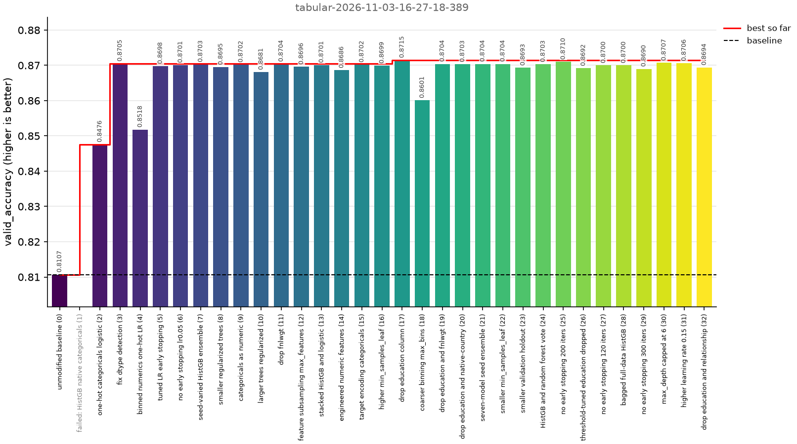

# Nograd-agent: No-grad Agent Descent

This repository gives code to run Autoresearch with [Syne Tune](https://github.com/syne-tune/syne-tune). 
In case you know what grad-student descent is, this repo is doing no-grad agent descent as agents are *not yet*
differentiable.

A coding agent (Claude Code) proposes new versions of a training script, and Syne Tune
runs and scores them as trials. The example task improves a small scikit-learn
classifier on the Adult census income dataset.



The key benefits are to get:
- trial abstractions and execution: multiprocessing / multiGPU supported out of the box
- easy to report scores without modifying train.py functions by just setting regexp
- early stopping / successive halving available out of the box

The repo is very much WIP, any feedback welcome. 

## Running

Requires [uv](https://docs.astral.sh/uv/) and the
[Claude Code CLI](https://docs.claude.com/en/docs/claude-code) (logged in).
To install:

```bash
git clone https://github.com/geoalgo/nograd-agent.git
cd nograd-agent
uv sync --extra examples --extra plot
```

Then run the search on the example task:

```bash
uv run nograd-agent --src_dir examples/tabular/task --max_trials 5
```

Settings are read from `nograd.yaml` in the source folder, options passed on
the command line override them, see `nograd-agent --help`. Agent
conversations and candidate scripts are written to the folder printed at the
end of the run, together with the settings used.

At the end of the search, unless `--skip_analysis` is passed, and at any time
with `nograd-analyse`, the search is summarized with statistics in text and a
bar plot of the metric per candidate labelled by Claude Haiku (`--label_model` to change it,
`--no_llm_labels` to skip it):

```bash
uv run nograd-analyse                 # latest search, plot in <search>/analysis.png
uv run nograd-analyse ~/syne-tune/<search> --output plot.png
```


To train and evaluate the current script by hand:

```bash
cd examples/tabular/task && uv run python train.py
```

To run the tests:

```bash
uv run pytest tests
```

## Using it on another task

Put the training script in a folder, by default `train.py`, which prints the
metric to optimize as `<metric>: <value>` or `<metric>=<value>`; the last
such line is used. Describe the task in a prompt and set the metric in
`nograd.yaml`:

```yaml
metric: valid_accuracy
mode: max                  # or min
prompt_file: PROMPT.md     # or `prompt: ...`
frozen_files: [eval.py]    # files the agent can read but not change
```

Then run `nograd-agent --src_dir <folder>`. The whole folder is copied to
every trial and paths are relative to it. Other settings:

- `train_script`: the script run in every trial, default `train.py`
- `editable_files`: files the agent may change, default the train script
- `eval_script`: a script run after training, from whose output the metric is
  then parsed; it is frozen
- `metric_regex`: regular expression whose first group is the value of the
  metric, for other output formats
- `n_workers`, `max_trials`, `trial_timeout`, `model`, `effort`, `name`,
  `skip_analysis`

Frozen files are read-only for the agent and restored in every trial, which
fails if training changed them. This catches mistakes, candidates are trusted
not to cheat on purpose: the training script prints its own score.

## Related repos

* the [original AutoResearch](https://github.com/karpathy/autoresearch) from Karpathy, which
is minimal (mostly a markdown file). That is great, but it does not offer many features either
* On the HPO / autoresearch space I am only aware of [autotune](https://github.com/RobertTLange/autotune), which derives a search space from your program, whereas
nograd-agent uses autoresearch as a *searcher* in a standard hyperparameter optimization library
* this [repo](https://github.com/ferreirafabio/autoresearch-automl) is also nice and benchmarks autoresearch against standard HPO methods, whereas nograd-agent can combine autoresearch with them.
